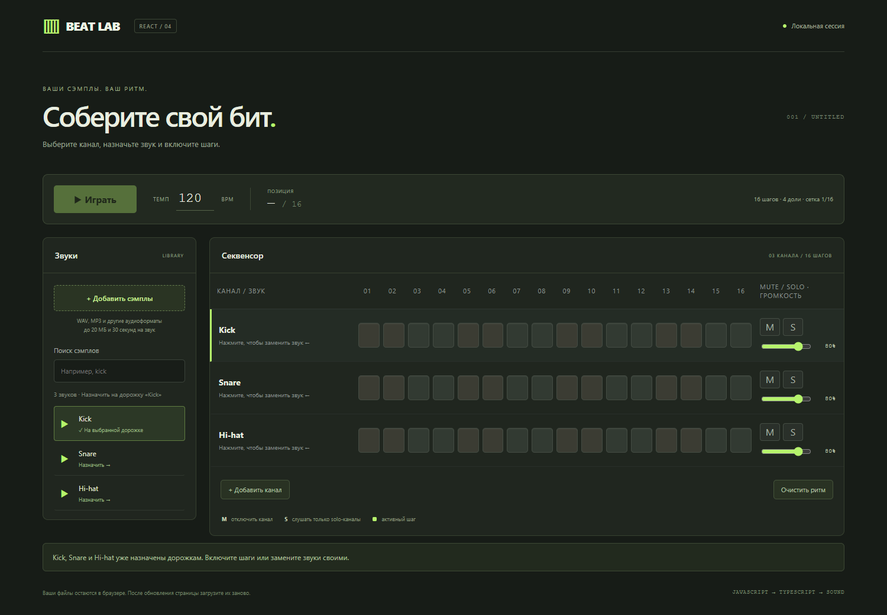
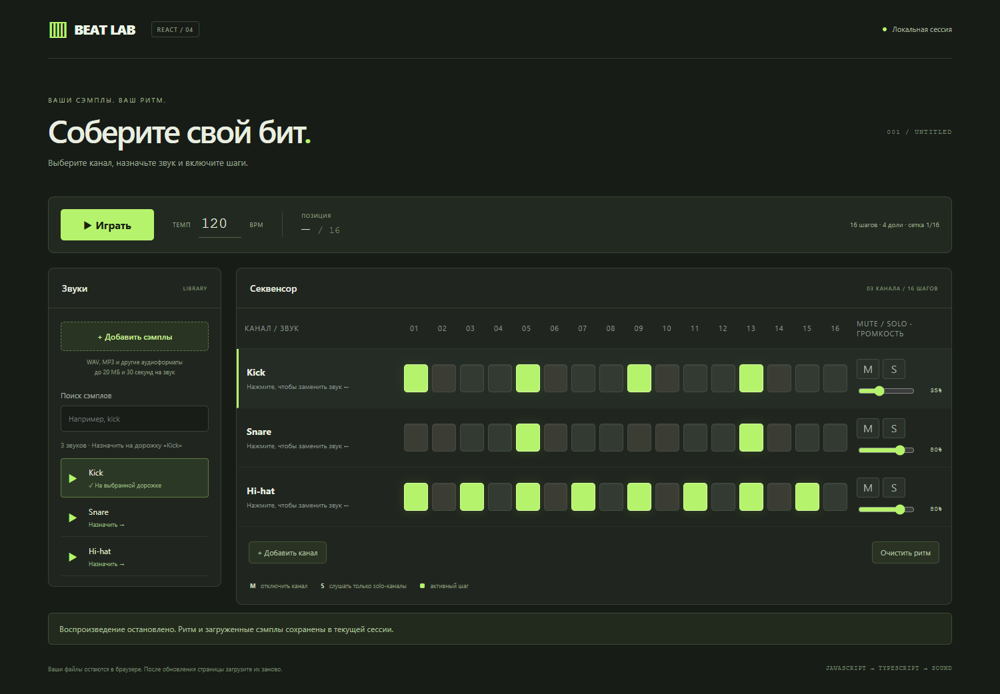
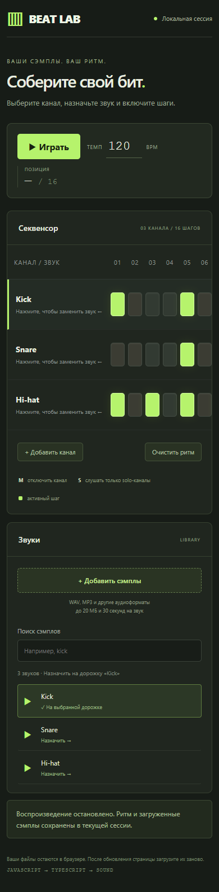

# BEAT LAB — лабораторная работа №4

Студент: **13**. Задание: [шаговый секвенсор и браузер звуков](../../tasks/13.md).

Два проекта на React и TypeScript:

- `ui-library` — библиотека компонентов `StepSequencer` и `SoundBrowser`.
- `frontend` — рабочее приложение, использующее библиотеку как локальный пакет
  `@student-13/music-ui` через `file:../ui-library`.

Сторонних UI-компонентов и аудиобиблиотек нет. Настройки ESLint и диапазоны
версий зависимостей основаны на примере преподавателя. Для воспроизводимой
установки в обоих проектах есть `package-lock.json`.

## Запуск в Windows / VS Code

Нужен Node.js 22.12+ или современная LTS-версия. Откройте терминал в папке
`lab4-react/solutions/student-13`.

Сначала установите и соберите библиотеку:

```powershell
cd ui-library
npm.cmd ci
npm.cmd run build
```

Затем установите и запустите приложение:

```powershell
cd ../frontend
npm.cmd ci
npm.cmd run dev
```

Откройте адрес из терминала, обычно `http://127.0.0.1:5173`.
Для остановки сервера нажмите **Ctrl+C**. Приложение открывается через сервер
Vite, а не двойным нажатием на `index.html`.

В `ui-library` команда `npm.cmd run dev` запускает наблюдение за изменениями
библиотеки: `vite build --watch`. Она не открывает отдельную страницу — это
библиотека. При изменении её исходников можно держать эту команду в отдельном
терминале, а `frontend` запускать во втором. React не включается в сборку
библиотеки, Vite приложения использует единственный экземпляр React.

## Как пользоваться

1. Kick, Snare и Hi-hat уже доступны и назначены стартовым каналам. Можно
   сразу расставлять ритм. Для своих звуков нажмите **«Добавить сэмплы»**.
2. Нажмите название канала в секвенсоре: он выделится слева зелёной полоской.
3. В библиотеке нажмите ▶ для прослушивания. Нажмите имя файла для назначения
   звука выбранному каналу. Название канала обновится по имени файла.
4. Включите нужные шаги. Сетка содержит 16 шагов по четверти доли — один такт
   4/4 с разрешением 1/16. Четыре соседних шага составляют одну долю.
5. Нажмите **«Играть»**. Последовательность повторяется по кругу. Меняйте BPM,
   шаги и состояния M/S во время работы.
6. **M** отключает канал, **S** выделяет solo-каналы. Если есть хотя бы один solo,
   остальные молчат. Mute имеет приоритет над solo.
7. **«Добавить канал»** создаёт пустой канал; максимум — 8.
8. **«Очистить ритм»** выключает все шаги и останавливает звук, сохраняя сэмплы.
9. Справа у каждого канала — громкость 0–100%. Она применяется к новым ударам
   канала, включая запланированные при следующем обновлении очереди. Предпрослушивание
   в библиотеке имеет собственный фиксированный уровень и не меняет дорожку.

Назначение звука и его предпрослушивание — разные действия. Без загруженного
звука и включённого шага запуск заблокирован. Поиск в библиотеке не зависит
от регистра. Шаги и кнопки доступны через Tab и Enter/Space; состояние
переключателей обозначено `aria-pressed`.

## Свои звуки

В комплекте три коротких WAV, синтезированных специально для этого проекта:
Kick, Snare и Hi-hat (`frontend/public/sounds`). Они не взяты из FL Studio
или сторонних сэмпл-паков. Загружаются локальным сервером при первом прослушивании
или запуске и кэшируются в аудиодвижке.

Пользовательские файлы добавляются отдельно и не отправляются на сервер.
Они декодируются браузером в память. И встроенный, и пользовательский список
передаётся в компонент браузера звуков через props.

- До 32 звуков, до 20 МБ на файл и не длиннее 30 секунд каждый.
- Доступны расширения WAV, MP3, OGG, FLAC, M4A, AAC; фактическое декодирование
  зависит от кодека и браузера. Для коротких ударных удобнее WAV.
- Ошибка одного файла не отменяет загрузку остальных; сообщение появляется
  под рабочим окном.
- При обновлении страницы файлы и ритм сбрасываются. Сохранение проекта и
  аудиоэкспорт в это задание не входят. Встроенные звуки доступны снова после обновления.
- Собственные коммерческие библиотеки не нужно копировать в репозиторий.

## Устройство кода

```text
ui-library/src/
  types.ts             типы дорожки и звука
  StepSequencer.tsx    управляемая сетка, выбор канала, mute/solo
  SoundBrowser.tsx     список через props, поиск, выбор и предпрослушивание
  style.css           стили компонентов
  index.ts            экспорт компонентов и типов
  *.test.tsx          тесты интерфейса

frontend/src/
  App.tsx             состояние, загрузка и связь компонентов
  model.ts            создание каналов, ограничения и правила mute/solo
  audio.ts            декодирование аудио, прослушивание, планировщик
  main.tsx            подключение React к странице
  style.css           оформление приложения
  *.test.ts(x)        тесты приложения, модели и аудиодвижка
```

`StepSequencer` получает `tracks`, ID выбранной дорожки и обработчики выбора,
переключения шага, mute, solo и громкости. Дополнительно принимает `stepCount` и `playingStep`.
`SoundBrowser` получает `sounds`, `selectedSoundId`, `onSelect` и `onPreview`;
`disabled` блокирует действия на время загрузки. `targetName` показывает, какой
дорожке будет назначен выбранный звук. Сам список звуков в компоненте
не зашит. Оба компонента экспортируют типизированные интерфейсы props.

Данные шагов хранятся в React state приложения, компоненты сообщают о действиях
через callbacks. Входные props напрямую не изменяются. Внутреннее состояние
браузера звуков хранит только поисковую строку.

Аудиодвижок использует Web Audio API. Таймер раз в 25 мс планирует звуки на
100 мс вперёд; фактический старт назначается через `AudioBufferSourceNode.start`
по `AudioContext.currentTime`. Длительность шага — `60 / BPM / 4` секунд.
Индикатор шагов следует запланированному аудиовремени. Изменения ритма и mute/solo
влияют на ещё не запланированные звуки: возможна задержка до горизонта очереди.
Стоп отменяет очередь и активные источники. При скрытии вкладки звук останавливается.

## Проверки обоих проектов

В каждой из папок `ui-library` и `frontend`:

```powershell
npm.cmd run lint
npm.cmd run lint:fix
npm.cmd test
npm.cmd run test:coverage
npm.cmd run build
```

ESLint сохраняет правила примера: отступы 2 пробела, отсутствие точек с запятой,
порядок импортов, ограничения пустых строк и правила React hooks. Дополнительно
включён запрет `var`; `any` запрещён настройками TypeScript ESLint.
TypeScript работает в strict-режиме. Типы выводятся компилятором либо задаются
явно; функции приложения и интерфейсы компонентов типизированы.

Проверки библиотеки: 10 тестов, оба компонента имеют **100% statements, branches,
functions и lines**. Порог Jest установлен в 90% по всем четырём показателям.

Проверки приложения: 15 тестов. Проверяются реальное связывание компонентов,
загрузка и ошибки, выбор канала, активные шаги, mute/solo, темп, play/stop,
планирование по аудиовремени и освобождение ресурсов. В Jest аудиоконтекст
подменён; отдельно выполнен браузерный сценарий с настоящим декодированием WAV
и запуском аудиоисточников. Субъективное звучание своих сэмплов нужно проверить
на своём устройстве.

## Скриншоты

Начальное состояние со встроенными звуками:



Приложение с 16 шагами, встроенными звуками и громкостью Kick 35%:



Скриншоты сделаны в настоящем приложении. На узком экране сетка прокручивается
внутри панели, остальные элементы доступны без горизонтальной прокрутки страницы:



## Сдача

- Ветка: `student-13-lab4`.
- Путь: `lab4-react/solutions/student-13/`.
- PR: `Lab 4 solution by student 13`.
- `node_modules`, `dist`, `coverage` и локальные настройки исключены из Git.
- Не требуется публиковать библиотеку в npm, создавать аккаунты или серверную API.
- Условия: [README лабораторной](../../README.md) и [чек-лист](../../tasks/check-list.md).
